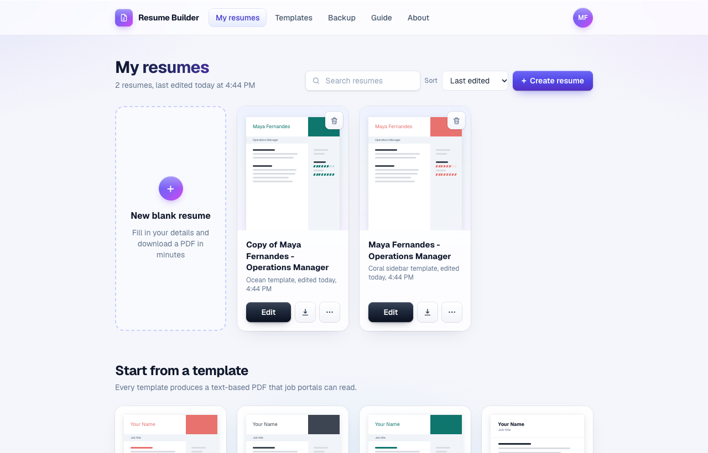
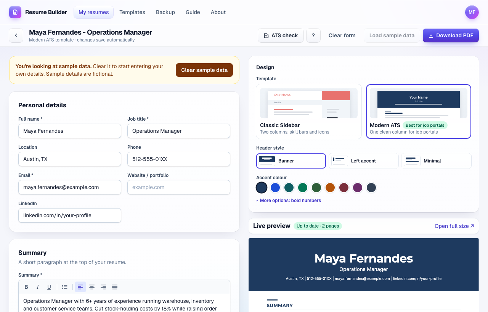

# Resume Builder

Build a clean, professional resume in your browser and download it as a **text-based PDF** that people and job portals (ATS) can read. No account, no server: your resumes stay on your device.

**Live app:** https://sanjayspear.github.io/resume-builder/





## Features

- **Live preview**: every page of the PDF updates as you type.
- **2 templates** that share the same content, so you can switch any time without losing anything (see [Templates](#templates)).
- **Rich text** in the Summary and job descriptions: bold, italic, underline, bullet lists, alignment.
- **Design controls**: font (Source Sans 3, Inter, Roboto, Gelasio, Carlito), text size, line spacing, logo size and accent colour (Classic Sidebar); five professional colours (Modern ATS).
- **Optional sections**: Projects, Certifications, a LinkedIn link and a city per job; they only appear in the PDF when filled in.
- **Work experience** sorted latest-first or oldest-first, with optional **company logos** (PNG/JPG/SVG or image URL).
- **Skill groups** with 1-10 rating bars, and **languages** with proficiency levels.
- **Starts with an example**: a new resume is filled with sample content so the preview shows the template properly. A banner offers **Clear sample data**, cards show a **Sample** badge, and downloading warns if example details (name, email, phone…) are still in the resume.
- **Clear form** with a confirmation and **Undo**; grey hints in the preview (never in the PDF) while fields are empty.
- **Many resumes**: search, sort, copy, rename, delete; everything auto-saves.
- **Backup file**: export all resumes to one file and import it on any browser or computer.
- Clear validation messages, keyboard-friendly menus and dialogs, and a built-in **user guide** (`/guide`).

## Templates

Pick a template per resume in the editor's **Design** panel. A template only changes the PDF design; the content is the same, and each template remembers its own colour.

| | Classic Sidebar | Modern ATS (*Best for job portals*) |
| --- | --- | --- |
| Layout | Two columns: main column + coloured sidebar | One column, top to bottom |
| Looks | Coloured header block, contact icons, skill rating bars, company logos | Header style: **Banner** (full-width colour band, white text), **Left accent** (colour bar beside the name) or **Minimal**; Montserrat headings with a short accent bar; metrics like 40% or $140K in bold (switchable) |
| Section order | Summary, Work experience, Projects, Education, Certifications; sidebar: contact, Skills, Languages, Sidebar summary | Summary, Skills, Work experience, Projects, Education, Certifications, Languages |
| Font | Your choice of five fonts, size and spacing | Montserrat (name, headings) + Inter 10 pt text, line height 1.35 (fixed); nine colours, each with at least 4.5:1 contrast against white |
| Not shown | – | Rating bars, logos, icons, and the Sidebar summary (it would repeat your Summary) |

Modern ATS follows common ATS rules: one column (text in the file is in reading order), only real text, standard headings, the contact line as `location | phone | email | website | LinkedIn`, and each job as `Title | Company, City` with the dates (`May 2025 – Present`) right-aligned on the same line. A very long contact line (website *and* LinkedIn) wraps onto a second line, still in the same order. The automated tests check these rules on the generated PDF.

Resumes saved before templates were reorganised open automatically: Coral, Slate and Ocean become **Classic Sidebar** (same look, same colour) and Minimal becomes **Modern ATS**.

## Privacy

Resumes are stored in the browser's `localStorage` and PDFs are created on your device; resume content is never uploaded. The only network request to another site happens when you paste a logo *URL*, to fetch that image. Clearing browsing data deletes your resumes, so use **Export backup** to keep a copy.

## Run it locally

Requires [Node.js](https://nodejs.org/) 20.9 or newer.

```bash
git clone https://github.com/sanjayspear/resume-builder.git
cd resume-builder
npm install
npm run dev
```

Then open http://localhost:3000.

| Command | What it does |
| --- | --- |
| `npm install` | Install dependencies (also copies the pdf.js worker into `public/`) |
| `npm run dev` | Development server at http://localhost:3000, reloads on save |
| `npm run build` | Production build (also type-checks the project) |
| `npm run build:pages` | Static build for GitHub Pages into `out/` (served from `/resume-builder/`) |
| `npm run lint` | Check the code with ESLint |
| `npm test` | PDF tests: render the sample resume with both templates and read the text back like an ATS (spelling, headings, reading order, dates, page breaks); sample mode, Clear form and loading of older saves |
| `npm run test:e2e` | Browser tests with [Playwright](https://playwright.dev/): build the app, create a resume, switch templates, download the PDF. First time: `npx playwright install chromium` |
| `npm run pdf:sample -- out.pdf [long\|styled\|features\|ats\|ats-long]` | Render the sample resume straight to a PDF file, no browser needed |

## Deployment

Every push to `main` builds a static version of the app and publishes it to GitHub Pages via [`.github/workflows/deploy.yml`](.github/workflows/deploy.yml). One-time setup in the repository: **Settings → Pages → Build and deployment → Source: GitHub Actions**.

The static build (`STATIC_EXPORT=1`) works because everything happens in the browser. Files in `public/` (fonts, the pdf.js worker) are referenced through `publicUrl()` in `src/lib/basePath.ts` so they also work under the `/resume-builder/` sub-path.

## Project structure

```
src/
  app/                    Pages: / (my resumes), /edit?id=…, /guide, /about
  components/
    home/                 My resumes page: cards, ⋯ menu, rename window
    editor/               Editor page: toolbar, auto-save, download
    form/                 Form sections, rich-text editor, logo upload
    LivePanel.tsx         Design panel + live PDF preview
    AppHeader.tsx         Top bar shared by all pages
  lib/
    schema.ts             Data shape + all validation rules (Zod)
    library.ts            Saved resumes: create, rename, copy, delete, backup, upgrades of old data
    libraryStore.ts       Shared, always-current view of saved resumes
    richText.ts           Formatted-text format + cleaning of pasted content
    experienceSort.ts     Date parsing and job ordering
    theme.ts, templates.ts  Design options and templates
    sampleMode.ts         New resumes start as the sample; sample detection; what Clear leaves
  pdf/
    ResumeDocument.tsx    Picks the template; the Classic Sidebar PDF layout
    ModernAtsDocument.tsx The Modern ATS PDF layout
    shared.tsx            Helpers both layouts use (e.g. ligatures off, see below)
    placeholders.ts       Grey hint text for empty fields (on-screen preview only)
public/fonts/             Fonts embedded in the PDF (SIL Open Font License 1.1)
scripts/render-sample.mts Render the sample resume to a PDF from the command line
tests/                    PDF tests (Node's built-in test runner + pdf.js text extraction)
e2e/                      Browser tests (Playwright)
```

## Built with

[Next.js](https://nextjs.org/), [React](https://react.dev/), [@react-pdf/renderer](https://react-pdf.org/), [pdf.js](https://mozilla.github.io/pdf.js/), [Tiptap](https://tiptap.dev/), [React Hook Form](https://react-hook-form.com/), [Zod](https://zod.dev/) and [Tailwind CSS](https://tailwindcss.com/).

Fonts: Source Sans 3, Inter, Roboto, Gelasio, Carlito and Montserrat, all under the SIL Open Font License 1.1. Gelasio and Carlito are metric-compatible alternatives to Georgia and Calibri, which can't be embedded.

## Troubleshooting

- **A CSS change (e.g. in `src/app/globals.css`) doesn't show up while `npm run dev` is running:** stop the dev server (`Ctrl + C`) and start it again. With this project's Tailwind setup the dev server sometimes keeps serving the old stylesheet; production builds are not affected.
- **Some characters are missing in the PDF:** the bundled fonts cover Latin-alphabet languages only.
- **Why are ligatures turned off?** Most fonts draw letter pairs like "ft", "ff" and "ffi" as one combined shape. Many ATS parsers then read only the first letter ("Software" becomes "Sofware"), which breaks keyword search. Both templates draw each letter separately; the layout is unchanged.
- **Why is kerning off in Modern ATS body text?** Inter's kerning tucks a full stop under a 7, so "97.1%" looked like "971%" and some extractors split it. Without kerning every character keeps its normal width. Heading letter spacing is also kept small (under 0.1 em) because wider spacing makes extractors read "S U M M A R Y".
- **Why does every PDF render call `repairGlyphCache()`?** It works around a bug in the font library (fontkit): after one PDF was made, a later PDF in the same browser session could get an empty entry in its glyph-to-letter map (typically for a curly apostrophe ’), and many text extractors and ATS then read the following letters wrongly ("REST" as "&EST"). See `src/pdf/fonts.ts`; `tests/roundtrip.test.tsx` and `e2e/text-layer.spec.ts` guard it.
- **`npm run test:e2e` says another server is running:** it uses port 3100. Stop whatever is using that port, or leave it if it's an up-to-date `next start` of this project (it will be reused).

## Contributing

Contributions are welcome. See [CONTRIBUTING.md](CONTRIBUTING.md).

## License

[MIT](LICENSE) © 2026 Sanjay Y M
