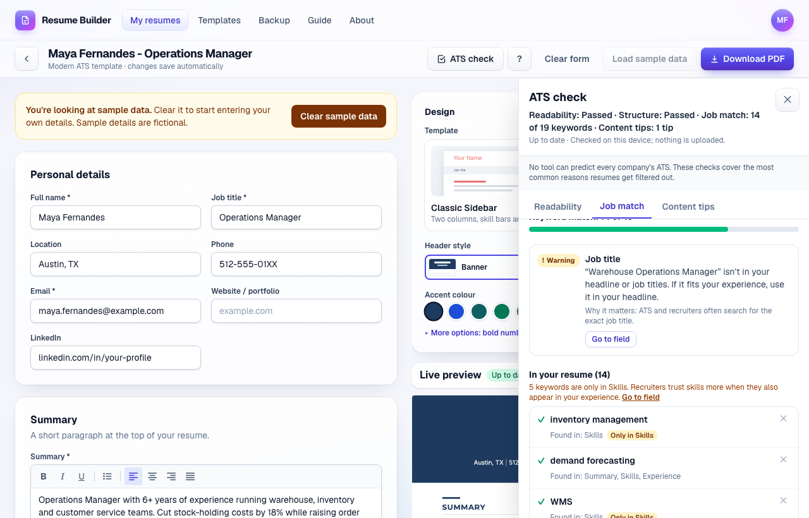

# Resume Builder

Build a clean, professional resume in your browser and download it as a **text-based PDF** that people and job portals (ATS) can read. No account, no server: your resumes stay on your device.

**Live app:** https://sanjayspear.github.io/resume-builder/

**Free for individuals and small businesses.** The source code is public under the [PolyForm Small Business License](LICENSE); larger companies need a [commercial licence](#commercial-use).


## Features

- **Live preview**: every page of the PDF updates as you type.
- **2 templates** that share the same content, so you can switch any time without losing anything: **Classic Sidebar** and **Modern ATS** (see [Templates](#templates)).
- **ATS check**: reads your real PDF back the way a resume scanner does, compares it with a job description, and gives content and spelling tips (see [ATS check](#ats-check)).
- **Spell check as you type**: red wavy underlines with suggestions, using English dictionaries (US and UK spellings both accepted), on your device.
- **Rich text** in the Summary and job descriptions: bold, italic, underline, bullet lists, alignment.
- **Design controls**: font (Source Sans 3, Inter, Roboto, Gelasio, Carlito), text size, line spacing, logo size and any accent colour (Classic Sidebar); header style, nine professional colours and bold metrics (Modern ATS).
- **Optional sections**: Projects, Certifications, a LinkedIn link and a city per job; they only appear in the PDF when filled in.
- **Work experience** sorted latest-first or oldest-first, with optional **company logos** (PNG/JPG/SVG or image URL).
- **Skill groups** with 1-10 rating bars, and **languages** with proficiency levels.
- **Starts with an example**: a new resume is filled with sample content so the preview shows the template properly. A banner offers **Clear sample data**, cards show a **Sample** badge, and downloading warns if example details (name, email, phone…) are still in the resume.
- **Clear form** with a confirmation and **Undo**; grey hints in the preview (never in the PDF) while fields are empty.
- **Many resumes**: search, sort, copy, rename, delete; everything auto-saves.
- **Backup file**: export all resumes (including their ATS check settings) to one file and import it on any browser or computer.
- Clear validation messages, keyboard-friendly menus and dialogs, and a built-in **user guide** (`/guide`).

## Templates

Pick a template per resume in the editor's **Design** panel. A template only changes the PDF design; the content is the same, and each template remembers its own colour.

| | Classic Sidebar | Modern ATS (*Best for job portals*) |
| --- | --- | --- |
| Layout | Two columns: main column + coloured sidebar | One column, top to bottom |
| Looks | Coloured header block, contact icons, skill rating bars, company logos | Header style: **Banner** (full-width colour band, white text), **Left accent** (colour bar beside the name) or **Minimal**; Montserrat headings with a short accent bar; metrics like 40% or $140K in bold (switchable) |
| Section order | Summary, Work experience, Projects, Education, Certifications; sidebar: contact, Skills, Languages, Sidebar summary | Summary, Skills, Work experience, Projects, Education, Certifications, Languages |
| Font | Your choice of five fonts, size and spacing | Montserrat (name, headings) + Inter 10 pt text, line height 1.35 (fixed); nine colours, each with at least 4.5:1 contrast against white |
| Not shown | – | Rating bars, logos, icons, and the Sidebar summary (it would repeat your Summary) |

Modern ATS follows common ATS rules: one column (text in the file is in reading order), only real text, standard headings, the contact line as `location | phone | email | website | LinkedIn`, and each job as `Title | Company, City` with the dates (`May 2025 – Present`) right-aligned on the same line. A very long contact line (website *and* LinkedIn) wraps onto a second line, still in the same order. The automated tests check these rules on the generated PDF.

Resumes saved before templates were reorganised open automatically: Coral, Slate and Ocean become **Classic Sidebar** (same look, same colour) and Minimal becomes **Modern ATS**.

## ATS check

Click **ATS check** in the editor. A panel shows a summary such as *Readability: Passed · Structure: 1 warning - no LinkedIn · Job match: 14 of 19 keywords · Content tips: 1 tip*, and three tabs. There is deliberately no single "ATS score": ATS differ between companies, so every result is a clear, explainable check. Each problem says why it matters, and **Go to field** takes you to the field to fix. Everything runs on your device.



- **Readability**: builds the real PDF and reads it back. Every word must come out exactly as typed (and every character's letter mapping must be valid), in the right reading order, with standard section headings and no text only in images. Classic Sidebar gets a warning that two-column layouts can be read out of order, with a **Switch to Modern ATS** button.
- **Structure**: name, email, phone, city and LinkedIn; every job has a title, company and dates; one date style throughout (e.g. not "Sept 2017" next to "Oct 2022"); most recent job first; 1–2 pages; a 40–120 word summary; the file name Download will use.
- **Job match**: paste a job description (and, optionally, a target job title). You see *Keyword match: X of Y*, where each keyword was found (Summary, Skills, Experience…), and which are missing. Matching ignores case and word forms (test, tests, testing) and treats synonyms and acronyms as equal (CI/CD = continuous integration, JS = JavaScript). Remove keywords that don't matter or add your own; there's also a job-title check and a keyword over-use warning.
- **Content tips**: bullets without numbers, weak openings like "Responsible for" (with stronger verbs), long bullets, too few or too many bullets per job, the same opening verb again and again, clichés without evidence, personal details you can leave out (date of birth, marital status, full address), and **spelling** with suggestions. Tips can be dismissed and spelling mistakes ignored, per resume.

The skills dictionary, synonyms, filler words and extra spelling words are editable JSON files in `src/data/ats/`.

## Privacy

Resumes are stored in the browser's `localStorage` and PDFs are created on your device; resume content is never uploaded. The ATS check runs in the browser too: the job description you paste and your keyword choices are saved with the resume on your device (and in your backup file), never sent anywhere. Fonts and spelling dictionaries are served by the app itself. The only network request to another site happens when you paste a logo *URL*, to fetch that image. Clearing browsing data deletes your resumes, so use **Export backup** to keep a copy.

## Run it locally

Requires [Node.js](https://nodejs.org/) 20.9 or newer.

```bash
git clone https://github.com/sanjayspear/resume-builder.git
cd resume-builder
npm install
npm run dev
```

Then open http://localhost:3000.

| Command | What it does |
| --- | --- |
| `npm install` | Install dependencies (also copies the pdf.js worker and the spelling dictionaries into `public/`) |
| `npm run dev` | Development server at http://localhost:3000, reloads on save |
| `npm run build` | Production build (also type-checks the project) |
| `npm run build:pages` | Static build for GitHub Pages into `out/` (served from `/resume-builder/`), the same build the deploy workflow makes |
| `npm run preview:pages` | Serve that `out/` build like GitHub Pages does, at http://localhost:4173/resume-builder/, to test the live site locally |
| `npm run lint` | Check the code with ESLint |
| `npm test` | Unit and PDF tests: renders resumes with both templates and reads the text back like an ATS (every character, headings, reading order, dates, page breaks), plus the ATS check, job match, content tips, spell check, sample mode and loading of older saves |
| `npm run test:e2e` | Browser tests with [Playwright](https://playwright.dev/) against a production build: templates, sample data, ATS check, spelling underlines, downloads, and that no resume text is sent anywhere. First time: `npx playwright install chromium` |
| `npm run test:e2e:pages` | The same browser tests against the GitHub Pages build (static export under `/resume-builder/`) |
| `npm run pdf:sample -- out.pdf [long\|styled\|features\|ats\|ats-long]` | Render the sample resume straight to a PDF file, no browser needed |

## Deployment

Every push to `main` runs [`.github/workflows/deploy.yml`](.github/workflows/deploy.yml): lint, the unit/PDF tests and the browser tests, then a static build published to GitHub Pages. If any step fails, nothing is published. One-time setup in the repository: **Settings → Pages → Build and deployment → Source: GitHub Actions**.

The static build (`STATIC_EXPORT=1`, `PAGES_BASE_PATH=/resume-builder`) works because everything happens in the browser. Files in `public/` (fonts, the pdf.js worker, spelling dictionaries) are referenced through `publicUrl()` in `src/lib/basePath.ts` so they also work under the `/resume-builder/` sub-path. To try exactly what will be published: `npm run build:pages && npm run preview:pages`.

## Project structure

```
src/
  app/                    Pages: / (my resumes), /edit?id=…, /guide, /about
  components/
    home/                 My resumes page: cards, ⋯ menu, rename window
    editor/               Editor page: toolbar, auto-save, download, sample-data banner
    form/                 Form sections, rich-text editor, logo upload
    ats/                  ATS check panel: readability, job match and content tips tabs
    spell/                Spelling underlines in the form (shared spell check, suggestions menu)
    LivePanel.tsx         Design panel + live PDF preview
    ConfirmDialog.tsx     Yes/no dialogs (Clear form, download warnings…)
    AppHeader.tsx         Top bar shared by all pages
  data/ats/               Editable lists: skills, synonyms, filler words, extra spelling words
  lib/
    schema.ts             Data shape + all validation rules (Zod)
    library.ts            Saved resumes: create, rename, copy, delete, backup, upgrades of old data
    libraryStore.ts       Shared, always-current view of saved resumes
    richText.ts           Formatted-text format + cleaning of pasted content
    experienceSort.ts     Date parsing and job ordering
    theme.ts, templates.ts  Design options and templates
    sampleMode.ts         New resumes start as the sample; sample detection; what Clear leaves
    metrics.ts            Finds metrics (40%, $140K…) for Modern ATS bold numbers
    ats/                  ATS check rules (pure functions): readability, structure, keywords, tips, summary line
    spell/                Spell check: which words to check, the checker (nspell), background worker
    pdfText.ts            Reads a PDF back as text, plus byte-level checks (shared by the ATS check and the tests)
  pdf/
    ResumeDocument.tsx    Picks the template; the Classic Sidebar PDF layout
    ModernAtsDocument.tsx The Modern ATS PDF layout
    shared.tsx            Helpers both layouts use (e.g. ligatures off, see below)
    fonts.ts              Font registration + the glyph cache repair (see below)
    placeholders.ts       Grey hint text for empty fields (on-screen preview only)
public/fonts/             Fonts embedded in the PDF (SIL Open Font License 1.1)
scripts/
  render-sample.mts       Render the sample resume to a PDF from the command line
  serve-pages.mjs         Serve the GitHub Pages build locally (npm run preview:pages)
  copy-assets.mjs         Copies the pdf.js worker and dictionaries into public/ (runs after npm install)
tests/                    Unit and PDF tests (Node's built-in test runner + pdf.js text extraction)
e2e/                      Browser tests (Playwright)
```

## Built with

[Next.js](https://nextjs.org/), [React](https://react.dev/), [@react-pdf/renderer](https://react-pdf.org/), [pdf.js](https://mozilla.github.io/pdf.js/), [Tiptap](https://tiptap.dev/), [React Hook Form](https://react-hook-form.com/), [Zod](https://zod.dev/) and [Tailwind CSS](https://tailwindcss.com/). Tests: Node's test runner and [Playwright](https://playwright.dev/).

Fonts: Source Sans 3, Inter, Roboto, Gelasio, Carlito and Montserrat, all under the SIL Open Font License 1.1. Gelasio and Carlito are metric-compatible alternatives to Georgia and Calibri, which can't be embedded.

Spell check: [nspell](https://github.com/wooorm/nspell) (MIT) with the Hunspell English dictionaries [dictionary-en](https://github.com/wooorm/dictionaries) and dictionary-en-gb (MIT and BSD). They're copied into `public/dictionaries/` by `npm install` and served by the app itself; words the dictionaries lack (e.g. "onboarding") are in `src/data/ats/extra-words.json`.

## Troubleshooting

- **A CSS change (e.g. in `src/app/globals.css`) doesn't show up while `npm run dev` is running:** stop the dev server (`Ctrl + C`) and start it again. With this project's Tailwind setup the dev server sometimes keeps serving the old stylesheet; production builds are not affected.
- **Some characters are missing in the PDF:** the bundled fonts cover Latin-alphabet languages only.
- **Spelling isn't checked ("The spelling dictionary couldn't be loaded"):** the dictionaries are copied into `public/dictionaries/` by `npm install`; run it again if that folder is missing.
- **Why are ligatures turned off?** Most fonts draw letter pairs like "ft", "ff" and "ffi" as one combined shape. Many ATS parsers then read only the first letter ("Software" becomes "Sofware"), which breaks keyword search. Both templates draw each letter separately; the layout is unchanged.
- **Why is kerning off in Modern ATS body text?** Inter's kerning tucks a full stop under a 7, so "97.1%" looked like "971%" and some extractors split it. Without kerning every character keeps its normal width. Heading letter spacing is also kept small (under 0.1 em) because wider spacing makes extractors read "S U M M A R Y".
- **Why does every PDF render call `repairGlyphCache()`?** It works around a bug in the font library (fontkit): after one PDF was made, a later PDF in the same browser session could get an empty entry in its glyph-to-letter map (typically for a curly apostrophe ’), and many text extractors and ATS then read the following letters wrongly ("REST" as "&EST"). See `src/pdf/fonts.ts`; `tests/roundtrip.test.tsx` and `e2e/text-layer.spec.ts` guard it.
- **`npm run test:e2e` says another server is running:** it uses port 3100 (`test:e2e:pages` uses 4173). Stop whatever is using that port, or leave it if it's an up-to-date server for this project (it will be reused).

## Contributing

Contributions are welcome. See [CONTRIBUTING.md](CONTRIBUTING.md) and the [Code of Conduct](CODE_OF_CONDUCT.md). Found a security problem? Please report it privately, as described in [SECURITY.md](SECURITY.md).

## License

Resume Builder is **source-available** under the [PolyForm Small Business License 1.0.0](LICENSE) © 2026 Sanjay Y M. In short (the [licence text](LICENSE) is what counts):

- **Free** for personal use, education, non-profits, and companies with fewer than 100 people **and** less than about USD 1 million in yearly revenue. You may use, change and share the app on those terms.
- **Larger companies need a commercial licence**: see [Commercial use](#commercial-use).
- The software comes as is, without warranty.

Versions published before 24 November 2026 (up to commit `fd665cb`) were released under the MIT License; copies obtained then remain under MIT.

### Commercial use

If your company has 100 or more people, or about USD 1 million or more in yearly revenue, and wants to use Resume Builder (for example to host it for customers or students, include it in a product, or use it in a paid service), please get a commercial licence. For questions or commercial licensing, [open an issue on GitHub](https://github.com/sanjayspear/resume-builder/issues) or contact me via [github.com/sanjayspear](https://github.com/sanjayspear). Include your company name, how you'd like to use it, and roughly how many people will use it.

### Third-party licences

Resume Builder includes third-party files under their own licences:

| What | Licence | Licence text |
| --- | --- | --- |
| Fonts in `public/fonts/` (Source Sans 3, Inter, Roboto, Gelasio, Carlito, Montserrat) | SIL Open Font License 1.1 | [`public/fonts/OFL.txt`](public/fonts/OFL.txt) |
| English spelling dictionaries (Hunspell, from SCOWL), copied into `public/dictionaries/` by `npm install` | MIT and BSD-style | `public/dictionaries/*.LICENSE.txt` (copied with them) |
| pdf.js worker, copied into `public/` by `npm install` | Apache 2.0 | Notice included at the top of the file |
| npm packages (Next.js, React, react-pdf, Tiptap, nspell…) | Their own open-source licences | In each package under `node_modules/` |
